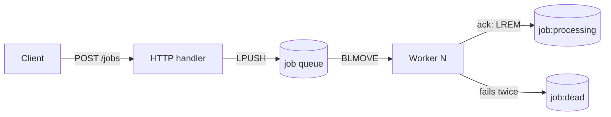

# message-queue

A small message queue I built in Go to learn how producers, queues and consumers work together.

You send a job to an HTTP endpoint, it gets pushed into a Redis list, and a few goroutines pick jobs up from the other end and simulate the work in the background. Each job has a type (`send_email`, `resize_image`, or `generate_pdf`) and a single string payload.



The endpoint replies `202 Accepted` as soon as the job is in Redis, it doesn't wait for the processing to finish.

## Job types

The work is simulated: no email is sent, no image is resized, and no PDF is generated.

| Type | Payload | Simulation |
|---|---|---|
| `send_email` | recipient address | waits 1s and logs the email |
| `resize_image` | image name | waits 2s and logs the new size |
| `generate_pdf` | report title | waits 3s and logs the PDF |

To make retries visible, jobs whose ID is divisible by 3 fail every attempt, and jobs divisible by 4 fail once. A job is tried twice; after that it is moved to the dead list.

## How to run it

You need Go and Redis.

Start Redis:

```bash
redis-server
```

Then run the server:

```bash
go mod tidy
go run ./cmd/server
```

It listens on `localhost:8080`. Send a single job like this:

```bash
curl -X POST localhost:8080/jobs \
  -H "Content-Type: application/json" \
  -d '{"id":1,"type":"send_email","payload":"alice@example.com"}'
```

The other job types:

```bash
curl -X POST localhost:8080/jobs \
  -H "Content-Type: application/json" \
  -d '{"id":2,"type":"resize_image","payload":"photo.jpg"}'

curl -X POST localhost:8080/jobs \
  -H "Content-Type: application/json" \
  -d '{"id":5,"type":"generate_pdf","payload":"Monthly report"}'
```

Send multiple jobs:

```bash
for i in $(seq 1 20); do
  curl -s -X POST localhost:8080/jobs \
    -H "Content-Type: application/json" \
    -d "{\"id\":$i,\"type\":\"send_email\",\"payload\":\"user$i@example.com\"}" > /dev/null
done
```

Test bad requests:

```bash
curl -i localhost:8080/jobs                                             # 405
curl -i -X POST localhost:8080/jobs -d 'not json'                       # 400
curl -i -X POST localhost:8080/jobs \
  -H "Content-Type: application/json" \
  -d '{"id":0,"type":"send_email","payload":""}'                        # 400
curl -i -X POST localhost:8080/jobs \
  -H "Content-Type: application/json" \
  -d '{"id":1,"type":"unknown","payload":"x"}'                          # 400
```

You'll see the worker pick it up in the server logs and log the simulated work.

## Project layout

```
cmd/server        starts everything
internal/producer the HTTP handler
internal/queue    talks to Redis and defines Job
internal/consumer the worker goroutines and simulated jobs
```

## Known limitations

This is a learning project, not something to run in production. The jobs are simulated. Delivery is at-least-once: if a process crashes after the work but before the ack, the same job can run again. If a worker crashes mid-job, the entry stays in `job:processing` — there is no recovery or reclaim yet.

